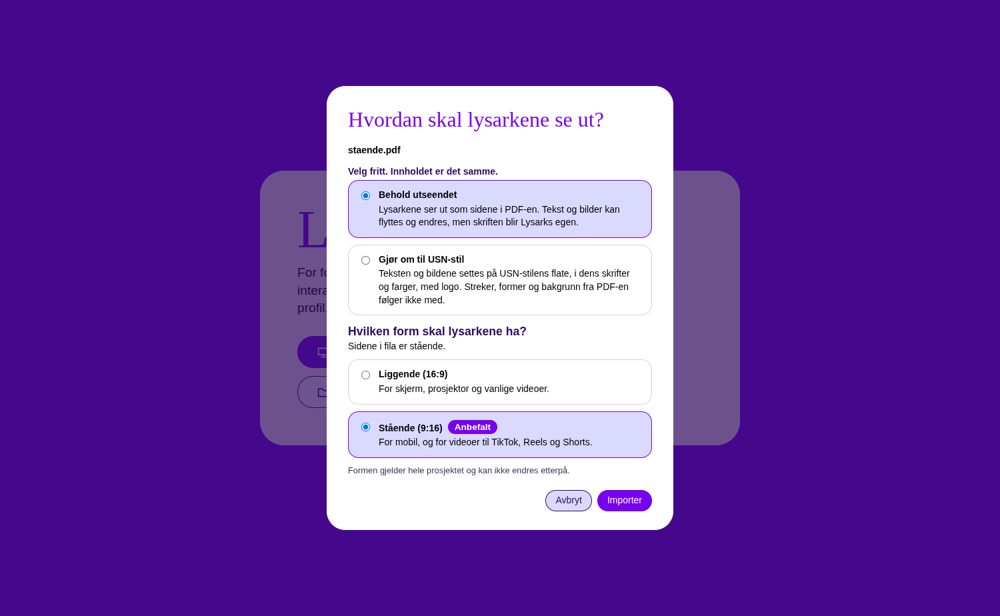
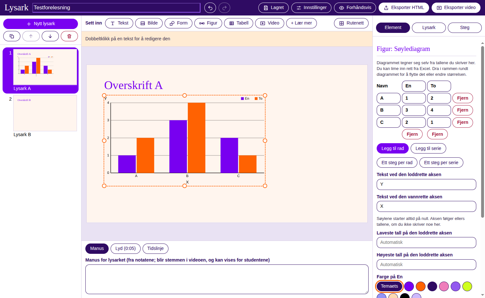
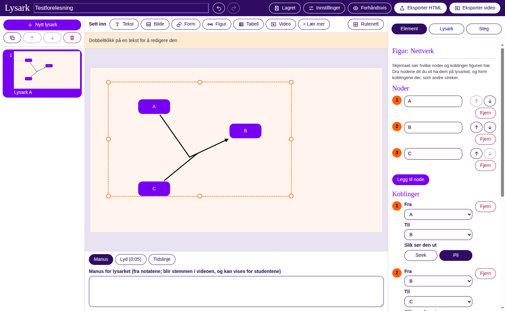
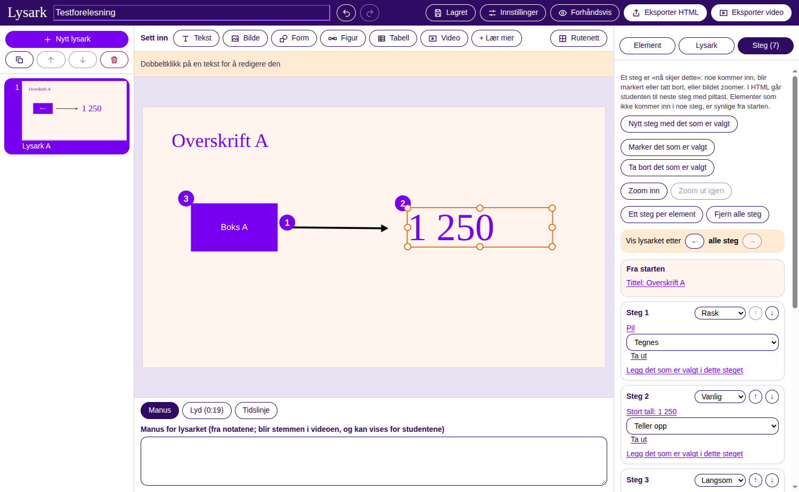
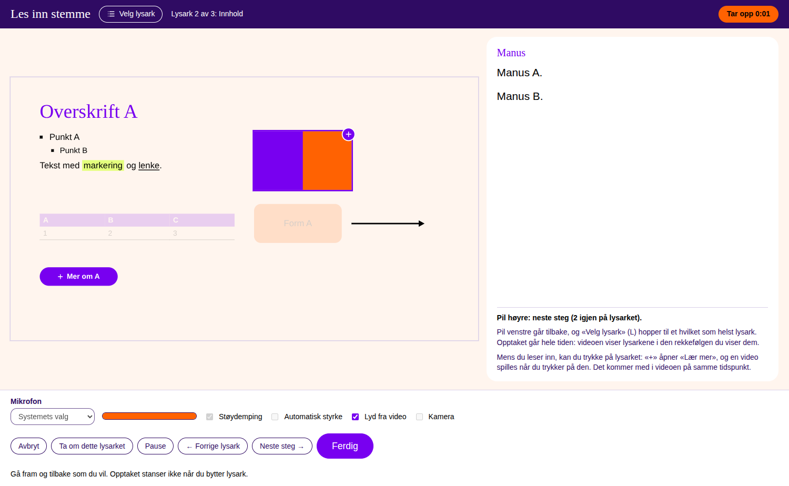
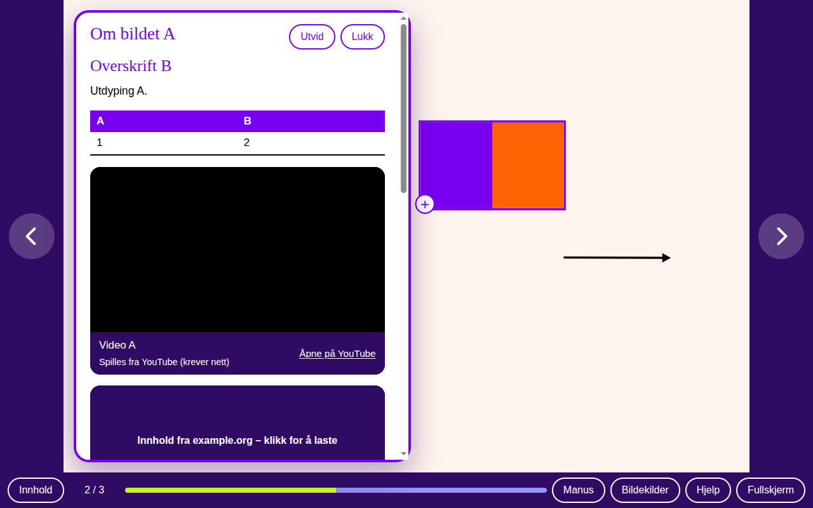

# Lysark

Lysark er et program for forelesere. Du tar en forelesning du allerede
har, i PowerPoint eller PDF, og får

- en **interaktiv nettside i én fil** som studentene åpner i nettleseren,
  og
- en **video** med stemmen din og teksting.

Programmet er gratis og på norsk, og virker på Windows 11 og på Linux
(Mint, Ubuntu). Du trenger ikke nett for å bruke det.

## Installer

### Windows

1. Åpne [siste utgivelse](https://github.com/SimenKode/lysark/releases/latest).
2. Last ned fila som slutter på `-windows-installasjon.exe`.
3. Dobbeltklikk på fila.

Det er alt. Lysark installeres, legger seg på skrivebordet og i
Start-menyen, og starter av seg selv. Du trenger ikke
administratorrettigheter, og det tar et minutt eller to.

Første gang kan Windows vise «Windows beskyttet PC-en din». Trykk «Mer
informasjon» og så «Kjør likevel». Advarselen kommer fordi programmet
ikke er signert, ikke fordi noe er galt med det.

Vil du ikke installere noe, kan du i stedet laste ned fila som slutter
på `-win.zip`, pakke den ut og dobbeltklikke på `Lysark.exe`.

### Linux

1. Åpne [siste utgivelse](https://github.com/SimenKode/lysark/releases/latest).
2. Last ned fila som slutter på `.AppImage`.
3. Høyreklikk på fila, velg «Egenskaper» og «Rettigheter», og kryss av
   for at fila kan kjøres som et program.
4. Dobbeltklikk på fila.

## Slik bruker du Lysark

### 1. Hent inn forelesningen

Trykk «Importer PowerPoint» eller «Importer PDF» og velg fila. Lysark
spør hvordan lysarkene skal se ut:

- **«Behold utseendet»**: lysarkene ser ut som i fila di.
- **«Gjør om til USN-stil»**: innholdet settes inn i Lysarks eget
  utseende. Stående søylediagram og linjediagram fra PowerPoint tegnes
  da på nytt, med de samme tallene.

Så spør Lysark hvilken form lysarkene skal ha: **«Liggende (16:9)»**
for skjerm, prosjektor og vanlige videoer, eller **«Stående (9:16)»**
for mobil og for videoer til TikTok, Reels og Shorts. Lysark ser på
sidene i fila og merker formen som passer, med «Anbefalt».

Uansett hva du velger, kan tekst og bilder flyttes og endres etterpå.
Seksjonene i PowerPoint og bokmerkene i en PDF blir kapitler. Lysark
sier fra om det som ikke kom med.

### 2. Rett opp lysarkene

Klikk for å velge, dra for å flytte, dobbeltklikk for å skrive.

**Figurer.** «Sett inn» og «Figur» gir deg en prosess, en lagvis
oppbygging, en sammenligning, en tidsakse, et søylediagram eller et
linjediagram. Du fyller ut et skjema, og figuren tegner seg selv. Tall
til et diagram kan du lime rett inn fra et regneark.

**Nettverk og streker.** «Nettverk» er en figur med noder og koblinger.
I skjemaet skriver du hvilke noder og koblinger som finnes, og på
lysarket drar du nodene dit du vil. Koblingene følger med. Alle streker
og piler kan formes: dra i midten av en strek for å bøye den. En ende
fester seg til en boks, eller til en annen strek, og følger med når den
flyttes.

**Steg.** Under «Steg» bestemmer du hva som skal skje, ett trykk om
gangen: noe kommer inn, noe markeres, noe tas bort, eller bildet zoomer
inn på et utsnitt. Lysark foreslår hvordan hver ting kommer inn: en pil
tegnes, søyler vokser, et stort tall teller opp. Du kan velge noe annet.

**«Lær mer».** Høyreklikk på hva som helst og velg «Legg til «Lær mer»»
for å gi studentene mer stoff: tekst, bilder, video, tabeller,
nettsider og figurer du har laget på et lysark. Bilder kan du søke fram
i Wikimedia Commons og Openverse, og Lysark setter inn hvem som har
laget dem. Studenten trykker på «+», og en boks spretter ut ved siden
av.

**Merker på et bilde.** Velg et bilde og trykk «Legg til merke» for å
peke ut det viktige i bildet, med tall og forklaring eller med
etiketter.

### 3. Les inn stemmen

Trykk «Les inn» i fanen «Lyd». Manuset står ved siden av lysarket mens
du snakker. Pil høyre går til neste steg eller neste lysark, pil venstre
går tilbake, og «Velg lysark» hopper dit du vil. Opptaket går hele
tiden, som et vanlig videoopptak: går du tilbake til et lysark, vises
det en gang til i videoen.

Vil du være med i bildet, krysser du av for «Kamera». Da vises ansiktet
ditt i en sirkel på lysarket, og blir med i videoen. Dra sirkelen dit
den ikke dekker noe, også mens du leser inn.

Når du trykker «Ferdig», lagres opptaket i bakgrunnen, og du kan
arbeide videre med lysarkene imens.

Etterpå kan du klippe bort feil, legge inn pauser og ta om et stykke.
Opptaket ditt endres aldri, så alt kan angres. Et lysark uten lyd står
så lenge du sier i feltet «Tid uten lyd», og du kan velge at et lysark
ikke skal være med i videoen.

### 4. Legg på musikk

I fanen «Tidslinje» står lysarkene på rad, med stemmen, musikken og
annen lyd under. Dra en lydfil på plass, og musikken dempes av seg selv
mens du snakker. Lysark følger ikke med musikk; bruk filer du har lov
til å bruke.

### 5. Eksporter

- **«Eksporter HTML»** gir én fil du legger ut til studentene. Har du
  lest inn stemmen, kan de trykke «Spill av».
- **«Eksporter video»** gir en MP4-fil med kapitler og med teksting
  ved siden av, eller en GIF av et kort klipp. Du kan også lage en
  video av bare noen få lysark. Et stående prosjekt gir en stående
  video.

### Dette får studentene

En forelesning de blar i selv, med piltaster eller mus. «+» åpner det du
har lagt i «Lær mer», og «Innhold» viser kapitlene.

## Greit å vite

- **Utseendet.** Lysark har valgt de samme fargene, formene og
  skrifttypene som den visuelle profilen til Universitetet i
  Sørøst-Norge (USN). USNs logo følger ikke med; har du logopakka fra
  USN, peker du på den under «Innstillinger».
- **Nett.** Programmet kontakter nettet bare når du selv søker etter et
  bilde i Wikimedia Commons eller Openverse, eller henter et
  forhåndsbilde fra YouTube. Da sendes bare søkeordene. Ingenting skjer
  i bakgrunnen.
- **Mikrofon og kamera.** Mikrofonen brukes bare mens du leser inn.
  Kameraet brukes bare der, og bare når du selv har slått det på.
  Opptakene lagres i prosjektmappa og sendes ingen steder.
- **Bilder du søker fram** får opphavsperson, lisens og kilde med seg,
  og Lysark viser det for studentene. Lysark bruker Openverse, men er
  ikke godkjent eller støttet av Openverse.
- **YouTube** spiller rett i lysarket hos studentene. I videofila står
  en YouTube-video som stillbilde.
- **Formen** (liggende eller stående) velger du når prosjektet lages,
  og den gjelder hele prosjektet.
- **Plass på disken.** Opptak du har tatt om, blir liggende i
  prosjektmappa. «Fil» og «Rydd i prosjektmappa» legger det som ikke
  brukes, i papirkurven.

## Om prosjektet

Lysark er et privat prosjekt. Det er ikke laget, eid eller godkjent av
USN.

Programmet er fri programvare under
[GNU General Public License](LICENSE), versjon 3 eller senere, og kommer
uten garanti. **Forelesningene du eksporterer, er dine egne**, og kan
deles på de vilkårene du selv vil
([EXPORT-EXCEPTION.md](EXPORT-EXCEPTION.md)).

Vil du bygge programmet selv eller se hvordan det er laget, står det i
[docs/utvikling.md](docs/utvikling.md).
