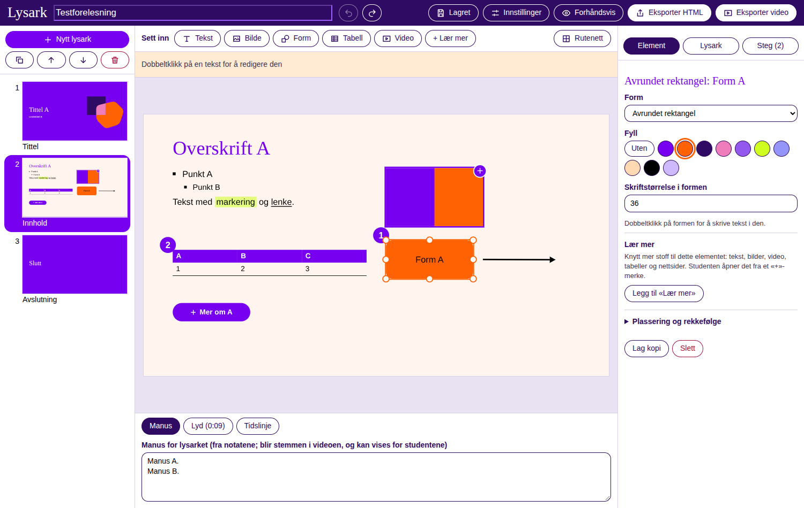
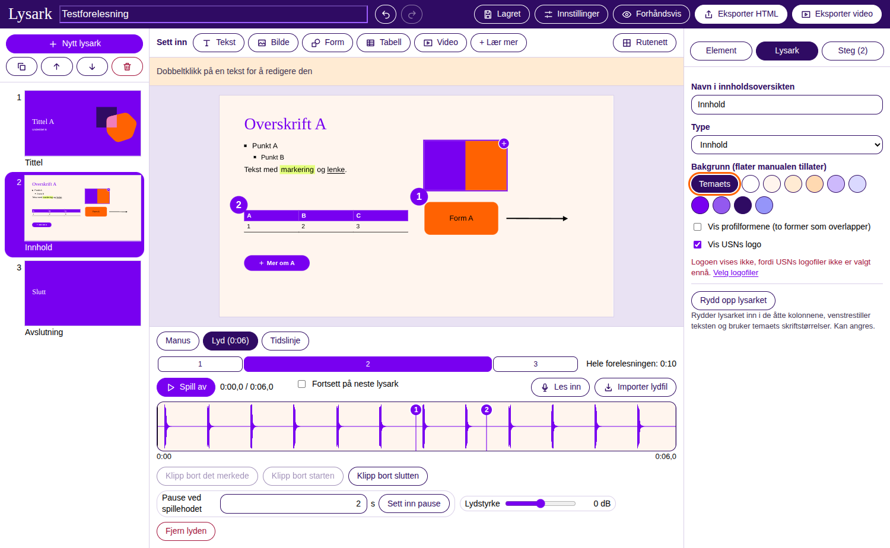
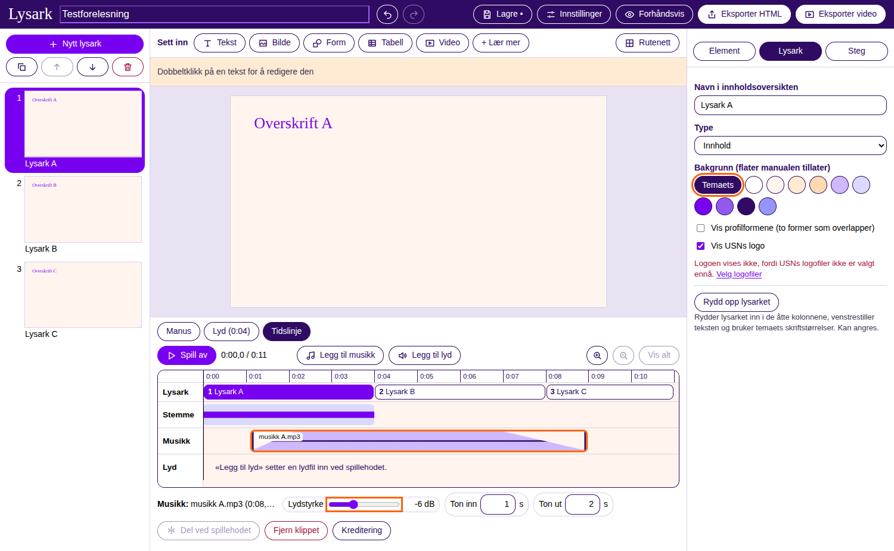

# Lysark

Lysark er et program for forelesere. Du tar en forelesning du allerede
har, i PowerPoint eller PDF, og får

- en **interaktiv nettside i én fil** som studentene åpner i nettleseren,
  og
- en **video** med stemmen din og teksting.

Programmet er gratis og på norsk, og virker på Windows 11 og på Linux
(Mint, Ubuntu). Du trenger ikke nett for å bruke det.

## Installer

### Windows

1. Åpne [siste utgivelse](https://github.com/SimenKode/lysark/releases/latest).
2. Last ned fila som slutter på `-win.zip`.
3. Høyreklikk på fila og velg «Pakk ut alle».
4. Åpne mappa og dobbeltklikk på `Lysark.exe`.

Første gang kan Windows vise «Windows beskyttet PC-en din». Trykk «Mer
informasjon» og så «Kjør likevel». Advarselen kommer fordi programmet
ikke er signert, ikke fordi noe er galt med det.

### Linux

1. Åpne [siste utgivelse](https://github.com/SimenKode/lysark/releases/latest).
2. Last ned fila som slutter på `.AppImage`.
3. Høyreklikk på fila, velg «Egenskaper» og «Rettigheter», og kryss av
   for at fila kan kjøres som et program.
4. Dobbeltklikk på fila.

## Slik bruker du Lysark

### 1. Hent inn forelesningen

Trykk «Importer PowerPoint» eller «Importer PDF» og velg fila. Lysark
lager et prosjekt med ett lysark per side, og sier fra om det som ikke
kom med.

### 2. Rett opp lysarkene

Klikk for å velge, dra for å flytte, dobbeltklikk for å skrive. Under
«Steg» bestemmer du hva som skal komme inn ett for ett.

Høyreklikk på hva som helst og velg «Legg til «Lær mer»» for å gi
studentene mer stoff: tekst, bilder, video, tabeller og nettsider.
Studenten trykker på «+», og en boks spretter ut ved siden av.

### 3. Les inn stemmen

Trykk «Les inn» i fanen «Lyd». Manuset står ved siden av lysarket mens
du snakker. Pil høyre går til neste steg eller neste lysark.

Etterpå kan du klippe bort feil, legge inn pauser og ta om et stykke.
Opptaket ditt endres aldri, så alt kan angres.

### 4. Legg på musikk

I fanen «Tidslinje» står lysarkene på rad, med stemmen, musikken og
annen lyd under. Dra en lydfil på plass, og musikken dempes av seg selv
mens du snakker. Lysark følger ikke med musikk; bruk filer du har lov
til å bruke.

### 5. Eksporter

- **«Eksporter HTML»** gir én fil du legger ut til studentene. Har du
  lest inn stemmen, kan de trykke «Spill av».
- **«Eksporter video»** gir en MP4-fil med teksting ved siden av, eller
  en GIF av et kort klipp.

### Dette får studentene

En forelesning de blar i selv, med piltaster eller mus. «+» åpner det du
har lagt i «Lær mer».

## Greit å vite

- **Utseendet.** Lysark har valgt de samme fargene, formene og
  skrifttypene som den visuelle profilen til Universitetet i
  Sørøst-Norge (USN). USNs logo følger ikke med; har du logopakka fra
  USN, peker du på den under «Innstillinger».
- **Nett.** Programmet kontakter nettet bare når du selv søker etter et
  bilde i Wikimedia Commons eller henter et forhåndsbilde fra YouTube.
  Da sendes bare søkeordene. Ingenting skjer i bakgrunnen.
- **Mikrofon.** Brukes bare mens du leser inn. Opptakene lagres i
  prosjektmappa og sendes ingen steder.
- **Bilder fra Wikimedia Commons** får opphavsperson, lisens og kilde
  med seg, og Lysark viser det for studentene.
- **YouTube** spiller rett i lysarket hos studentene. I videofila står
  en YouTube-video som stillbilde.

## Om prosjektet

Lysark er et privat prosjekt. Det er ikke laget, eid eller godkjent av
USN.

Programmet er fri programvare under
[GNU General Public License](LICENSE), versjon 3 eller senere, og kommer
uten garanti. **Forelesningene du eksporterer, er dine egne**, og kan
deles på de vilkårene du selv vil
([EXPORT-EXCEPTION.md](EXPORT-EXCEPTION.md)).

Vil du bygge programmet selv eller se hvordan det er laget, står det i
[docs/utvikling.md](docs/utvikling.md).
